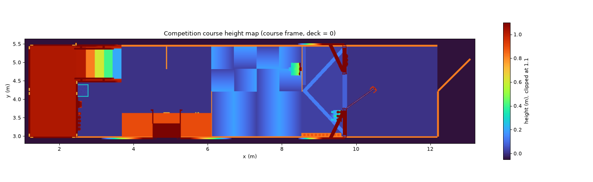

# Competition course (IEEE Humanoids 2026 Loco-Manipulation Challenge)

The testbed from the organizers' CAD, ready for MuJoCo, plus a 1 cm height map of it.



## Files

| File | What it is |
|---|---|
| `course.xml` | MuJoCo scene: floor plane + ~4,000 boxes and 11 ramp wedges built from the CAD |
| `course_heightmap.npz` | 1 cm height grid of the course: the "perfect height map" |
| `course_heightmap.png` | Top-down picture of the grid |
| `view_course.py` | Opens the course in the MuJoCo viewer with a G1 standing on it |
| `cad/` | The downloaded CAD (git-ignored, ~100 MB) |

Generated by [`tools/cad/`](../../tools/cad/). Don't edit `course.xml` by hand.

## Use it

Viewing and checking only need `mujoco` and `numpy` (already in the Docker image).

```bash
python sim/competition/view_course.py                   # G1 on the first stair
python sim/competition/view_course.py --spawn landing   # start | stepover | ramps | flat | stairs | landing | button5
python sim/competition/view_course.py --no-robot
python tools/cad/check_course.py                        # heights, landmarks, contacts
```

No policy runs in the viewer. The G1 holds its home pose with mjlab's motor model and Unitree's FixStand gains. A soft "gantry" spring keeps it upright while its feet carry the weight. Turn the spring off under Physics → Equality (or pass `--no-gantry`) and it tips over, as a real robot would without a controller.

Rebuild from the CAD (only needed if the organizers update it):

```bash
pip install -r tools/cad/requirements.txt
python tools/cad/fetch_testbed.py      # downloads and checks the CAD
python tools/cad/build_course.py       # CAD -> height grid -> course.xml (~20 s)
python tools/cad/check_course.py
```

## Course frame and height grid

- **Frame:** x and y are the CAD's, in meters; z is shifted so the main deck floor is z = 0. The course runs along x, from the stairs landing (x ≈ 1.2) to the start area (x ≈ 12.2).
- **Grid:** `heights[i, j]` is the top surface height at `x = x0 + i*res`, `y = y0 + j*res`, with `res = 0.01` m. Load it with `np.load("course_heightmap.npz")`.
- **What's simplified:**
  - The grid is 2.5D: anything starting more than 1.8 m above the deck (the door header) is dropped, so the doorway stays open.
  - Walls are cut at 1.8 m.
- **Movable things are baked in as they appear in the CAD:** the open door leaf, the milk crates, and the counter items.

## Measured dimensions

Measured from the CAD on 2026-10-28 (organizers' CAD sha256 `ce0d4344…427c`). The organizers say the final course may change slightly.

| Feature | Where (x, m) | Dimensions |
|---|---|---|
| Landing | 1.22 – 2.44 | 1.22 × 2.44 m, **1.022 m** above the deck |
| Stairs | 2.44 – 3.68 | **5 risers × 20.3 cm** (8"), treads ≈ 24 cm, 0.77 m between the side panels, handrails both sides |
| Flat section | 3.66 – 6.10 | 2.44 m; counter along one side, thin 0.81 m partition near x = 4.9 |
| Crossing ramps | 6.10 – 8.53 | 4 × 4 tiles of 0.61 m at **15°**, ridges ≈ 0.19 m; half "hill" (ridges across the path), half pinwheel |
| Step-over section | 8.54 – 9.75 | floor +2.6 cm; **two beams 10.2 cm tall, 8.8 cm wide, laid ≈ 47° diagonal in a V** |
| Door | x ≈ 9.75 | 0.93 m clear opening, sill **7.7 cm** high |
| Start area | 9.75 – 12.19 | flat |
| Lane walls | along both sides | 0.81 m tall |

The G1's foot (collision capsules) is about 20.6 cm long, so a 24 cm tread leaves about 3.5 cm to spare.

The last mobility button appears to sit at landing-floor level on the landing's front edge (x ≈ 2.5, y ≈ 3.15–3.55), right at the 1 m drop. That's why it needs a crouch. This location is inferred from the CAD, so confirm it.

## Why boxes and not the CAD mesh or a heightfield

- **CAD mesh:** MuJoCo collides each mesh as its convex hull, so the stairs would act like a solid wedge.
- **Heightfield:** a 1 cm heightfield copies the grid exactly. But every robot geom then touches hundreds of cells, so MuJoCo crawls and mjlab runs out of contacts.
- **Boxes:** because the course is lumber and plywood, boxes are exact:
  - Flat-topped parts are cut straight from the grid.
  - The 15° tiles are fitted wedges.
  - The beams are fitted rotated boxes.

  `check_course.py` confirms MuJoCo's surface matches the grid within about 1 mm on everything walkable. Anything taller than 1.1 m is rounded up to the next 5 cm, since nothing is walked on up there.
